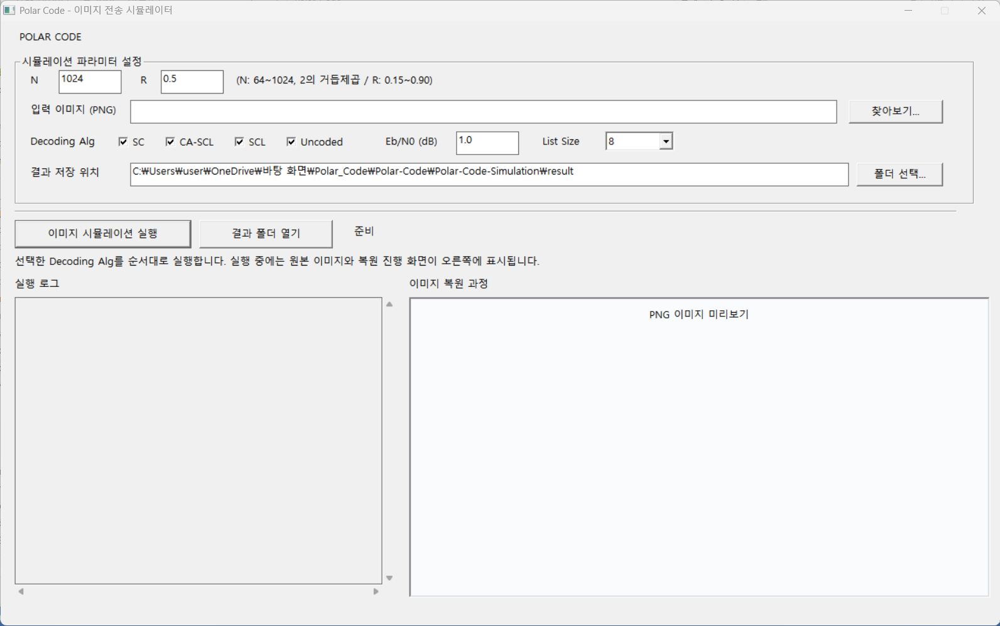
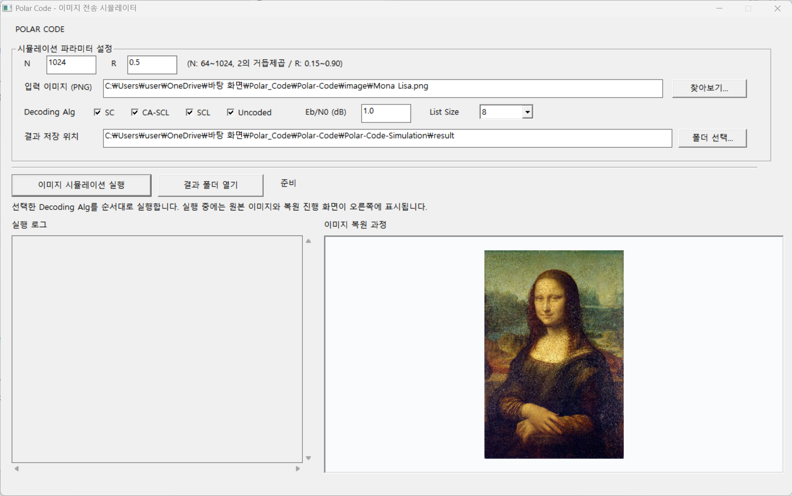
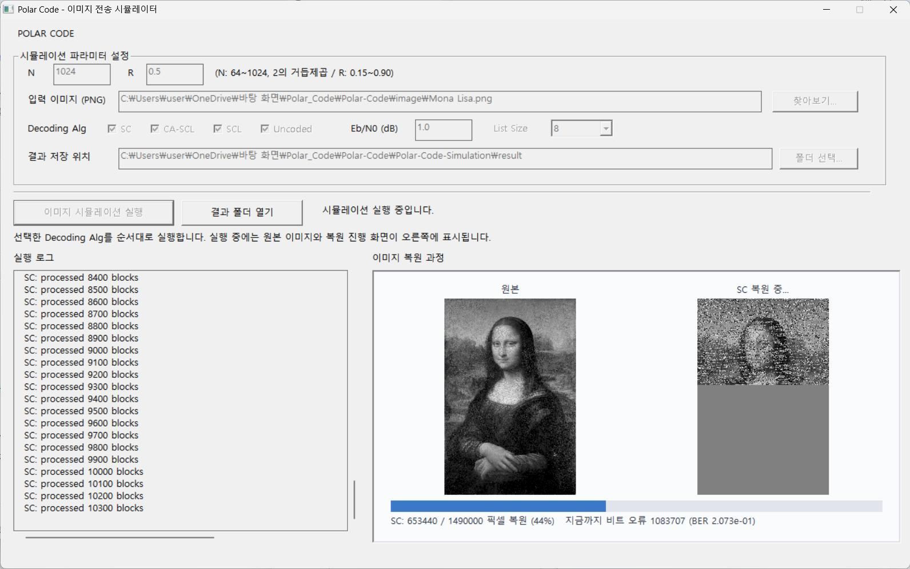
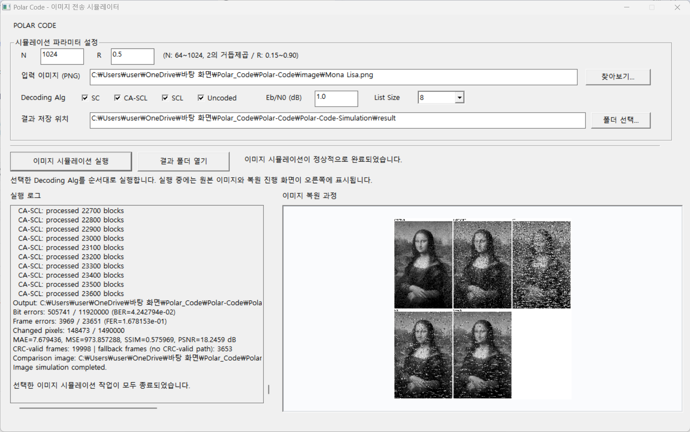

# Polar Code 이미지 전송 시뮬레이터

`PolarCode.exe`는 PNG 이미지를 입력해 Polar Code 기반 이미지 전송 및 복원 과정을 확인하는 Windows GUI 프로그램입니다. 사용자는 전송 조건과 복호 알고리즘을 선택하고, 실행 중에는 로그와 이미지 복원 진행 상황을 확인할 수 있습니다.


## 1. 실행 방법

1. `PolarCode.exe`를 실행합니다.
2. **입력 이미지 (PNG)** 옆의 **찾아보기** 버튼을 눌러 전송할 PNG 이미지를 선택합니다.
3. Polar Code 파라미터인 `N`과 `R`을 확인하거나 원하는 값으로 설정합니다.
4. 실행할 **Decoding Alg**를 하나 이상 체크합니다.
5. `Eb/N0 (dB)`를 입력하고, SCL 계열 알고리즘을 선택한 경우 `List Size`를 설정합니다.
6. **결과 저장 위치**를 확인합니다. 다른 위치에 저장하려면 **폴더 선택**을 눌러 저장 폴더를 지정합니다.
7. **이미지 시뮬레이션 실행** 버튼을 눌러 전송 및 복원을 시작합니다.
8. 실행 중에는 실행 로그와 오른쪽 복원 진행 화면을 확인합니다. 완료되면 **결과 폴더 열기**를 눌러 저장된 파일을 확인합니다.

## 2. 프로그램 화면

### 2.1 프로그램 시작 화면

프로그램을 처음 실행했을 때 표시되는 기본 화면입니다.



### 2.2 입력 이미지 선택

`찾아보기` 버튼을 눌러 시뮬레이션에 사용할 PNG 이미지를 선택합니다. 선택한 이미지의 경로가 입력란에 표시됩니다.



### 2.3 이미지 시뮬레이션 실행 중

`이미지 시뮬레이션 실행` 버튼을 누르면 선택한 알고리즘이 순서대로 실행됩니다. 왼쪽 실행 로그에서 처리 상황을 확인할 수 있으며, 오른쪽에는 원본 이미지와 복원 중인 이미지가 표시됩니다.



### 2.4 이미지 시뮬레이션 완료

선택한 알고리즘의 실행이 끝나면 완료 상태가 표시됩니다. 결과 폴더를 열어 복원 이미지와 비교 이미지를 확인할 수 있습니다.



### 2.5 실행 과정 동영상

아래 영상에서 입력 이미지 선택부터 시뮬레이션 실행 및 완료까지의 전체 과정을 확인할 수 있습니다.

[이미지 시뮬레이션 실행 영상 보기 (Video.mp4)](media/Video.mp4)

<video src="media/Video.mp4" controls width="100%">
  현재 사용하는 Markdown 뷰어에서 동영상 재생을 지원하지 않으면 위의 Video.mp4 링크를 눌러 영상을 열어 주세요.
</video>

## 3. 입력 항목 안내

### 3.1 입력 이미지 (PNG)

- 입력 파일은 PNG 형식이어야 합니다.
- 입력 이미지는 시뮬레이션 처리 과정에서 8비트 그레이스케일 이미지로 변환됩니다.
- 이미지 해상도가 클수록 처리할 데이터가 많아져 실행 시간이 길어질 수 있습니다.

### 3.2 Polar Code 파라미터

| 항목 | 설정 범위 | 기본값 | 설명 |
|---|---|---:|---|
| `N` | 64, 128, 256, 512, 1024 | 1024 | 부호어 길이 |
| `R` | 0.15~0.90 | 0.5 | 부호율 |

정보 비트 수 `K`는 다음 식을 기준으로 계산됩니다.

```text
K = round(N × R)
```

`N`은 2의 거듭제곱이어야 하며, 선택한 `N`과 `R`에 따른 `K`가 유효한 범위인지 확인해야 합니다.

### 3.3 Decoding Alg

실행할 복호 알고리즘을 체크박스로 선택합니다. 여러 알고리즘을 동시에 선택할 수 있으며, 선택한 알고리즘은 차례대로 실행됩니다.

| 알고리즘 | 설명 |
|---|---|
| `SC` | Successive Cancellation. 순차적으로 비트를 추정하는 복호 알고리즘입니다. |
| `SCL` | Successive Cancellation List. 여러 후보 경로를 유지하며 복호합니다. |
| `CA-SCL` | CRC-Aided Successive Cancellation List. CRC 검사를 활용해 후보 경로를 선택하는 복호 알고리즘입니다. |
| `Uncoded` | Polar Code를 적용하지 않는 기준 전송 방식입니다. |

프로그램을 처음 실행하면 네 알고리즘이 모두 선택되어 있습니다. 확인하려는 알고리즘만 남기고 나머지 체크를 해제할 수 있습니다. 최소 한 개의 알고리즘을 선택해야 시뮬레이션을 실행할 수 있습니다.

### 3.4 Eb/N0 (dB)

- 입력 가능 범위: `-20 dB`~`30 dB`
- 기본값: `1.0 dB`
- 이미지 전송 시 채널 조건으로 사용할 Eb/N0 값을 입력합니다.

### 3.5 List Size

List Size는 `SCL` 및 `CA-SCL` 알고리즘에서 사용하는 리스트 크기입니다.

- 선택 가능 값: `2`, `4`, `8`, `16`
- 기본값: `8`
- `SCL` 또는 `CA-SCL`을 하나라도 선택하면 설정할 수 있습니다.
- `SC`와 `Uncoded`만 선택한 경우에는 비활성화됩니다.

### 3.6 결과 저장 위치

- 기본 저장 위치는 `PolarCode.exe`가 있는 폴더 아래의 `result` 폴더입니다.
- 다른 위치에 저장하려면 **폴더 선택** 버튼을 눌러 원하는 폴더를 지정합니다.
- 지정한 폴더에 쓰기 권한이 있는지 확인해 주세요.

## 4. 실행 중 화면 및 진행 상황

시뮬레이션이 실행되는 동안 입력 설정과 실행 관련 컨트롤은 작업 중 변경되지 않도록 비활성화됩니다.

- **실행 로그**: 현재 실행 중인 알고리즘과 처리 블록 등의 진행 메시지를 표시합니다.
- **원본 이미지**: 전송에 사용되는 원본 이미지를 표시합니다.
- **복원 이미지**: 수신 및 복호가 진행되면서 복원되는 이미지를 표시합니다.
- **진행률**: 처리된 픽셀 수와 전체 픽셀 수를 바탕으로 진행 상태를 표시합니다.

진행 화면에는 현재까지 누적된 비트 오류 수나 BER이 함께 표시될 수 있습니다. 이는 해당 이미지 전송의 진행 정보를 보여주는 항목이며, Eb/N0를 변화시키며 BER/FER 성능 곡선을 분석하는 기능은 제공하지 않습니다.

여러 알고리즘을 선택한 경우 선택된 알고리즘이 순차적으로 실행됩니다. 실행 도중 프로그램을 종료하면 시뮬레이션이 중단될 수 있습니다.

## 5. 결과 파일

시뮬레이션 결과는 지정한 저장 폴더에 저장됩니다. 실제 생성되는 파일은 선택한 알고리즘에 따라 달라집니다.

| 파일명 | 내용 |
|---|---|
| `decoded_sc.png` | SC 복원 이미지 |
| `decoded_scl.png` | SCL 복원 이미지 |
| `decoded_ca_scl.png` | CA-SCL 복원 이미지 |
| `decoded_uncoded.png` | Uncoded 복원 이미지 |
| `comparison.png` | 네 알고리즘을 모두 실행한 경우 생성되는 결과 비교 이미지 |
| `original_gray.png` | 시뮬레이션에 사용된 그레이스케일 원본 이미지 |
| `gui_run.log` | 실행 로그 |

`live_frame.png` 및 `live_info.txt`는 실행 중 복원 화면과 진행 정보를 갱신하는 데 사용되는 파일입니다.

같은 결과 저장 폴더에서 다시 시뮬레이션을 실행하면 동일한 이름의 결과 파일이 새 결과로 갱신될 수 있습니다. 이전 결과를 보관하려면 실행 전에 별도 폴더를 지정하거나 기존 결과 파일을 다른 위치에 복사해 주세요.

## 6. 문제 해결

| 문제 상황 | 확인 및 해결 방법 |
|---|---|
| 프로그램이 실행되지 않음 | `PolarCode.exe`가 정상적으로 다운로드되었는지 확인하고 다시 실행해 주세요. 오류 창이 표시되면 오류 내용을 확인해 주세요. |
| PNG 이미지를 선택할 수 없음 | 선택한 파일의 확장자와 실제 파일 형식이 PNG인지 확인해 주세요. |
| 실행 버튼을 눌러도 시작되지 않음 | 입력 이미지, `N`, `R`, `Eb/N0`, 결과 저장 위치를 확인하고 알고리즘을 하나 이상 선택했는지 확인해 주세요. |
| `N` 또는 `R` 입력 오류가 발생함 | `N`은 64, 128, 256, 512, 1024 중 하나로 설정하고 `R`은 0.15~0.90 범위로 입력해 주세요. |
| List Size가 비활성화됨 | `SCL` 또는 `CA-SCL`을 선택했는지 확인해 주세요. |
| 결과 파일이 저장되지 않음 | 결과 저장 폴더의 경로가 올바른지, 해당 위치에 파일을 저장할 권한이 있는지 확인해 주세요. |
| 시뮬레이션 시간이 오래 걸림 | 입력 이미지의 해상도와 선택한 알고리즘 수에 따라 실행 시간이 달라집니다. 작은 해상도의 PNG 이미지나 일부 알고리즘만 선택해 먼저 실행해 볼 수 있습니다. |
| 실행 중 오류가 발생함 | 실행 로그와 결과 폴더의 `gui_run.log`를 확인해 주세요. 문제가 계속되면 오류 로그와 입력 조건을 함께 전달해 주세요. |

---
